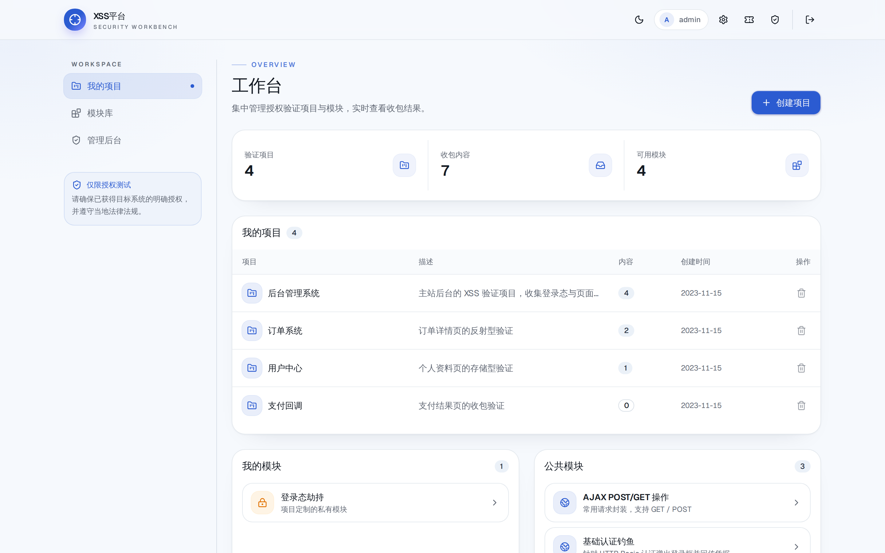
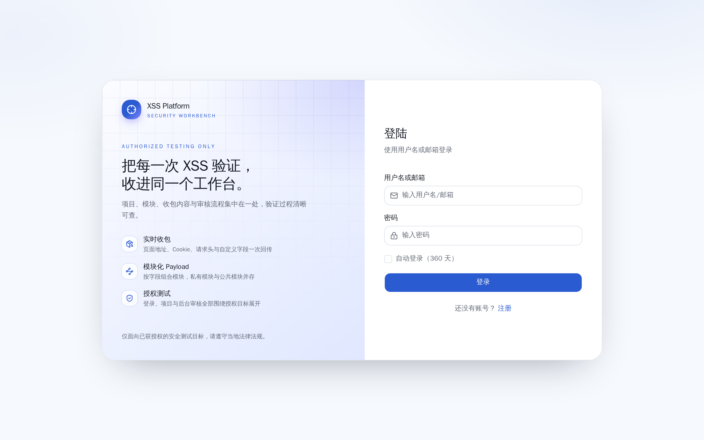
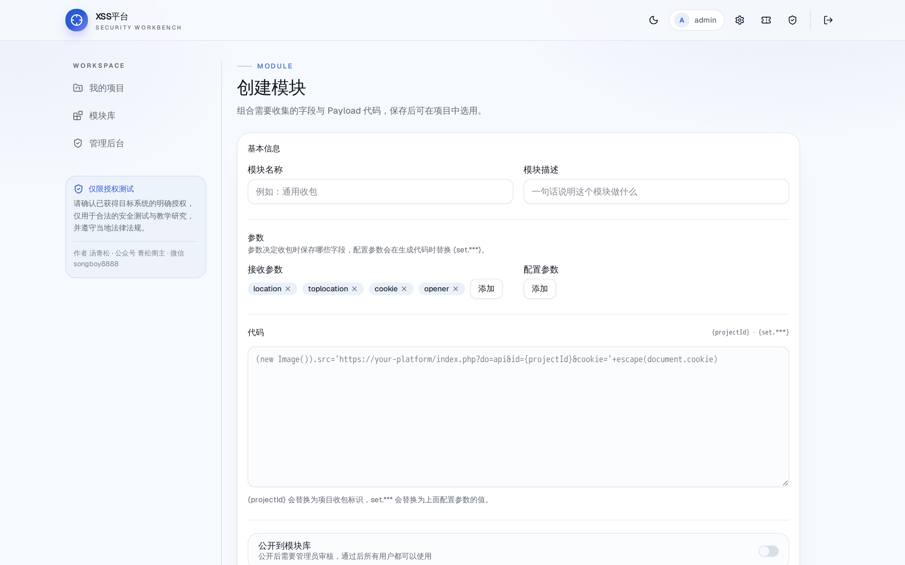
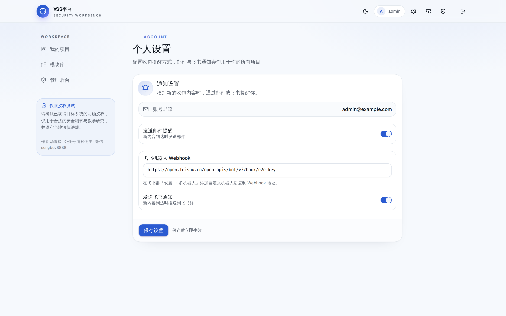

<div align="center">


<h1>XSS Platform</h1>

<p><strong>面向授权安全测试的 XSS 收包与验证工作台</strong></p>

<p>把 Payload 管理、项目收包、模块复用与审核流程放进同一个现代化界面。</p>

<p>
  
  
  
  
  
</p>

<p>
  <a href="https://github.com/78778443/xssplatform"></a>
  <a href="#界面">界面</a> ·
  <a href="#核心功能">核心功能</a> ·
  <a href="#快速开始">快速开始</a> ·
  <a href="#安全基线">安全基线</a> ·
  <a href="#开发与测试">开发与测试</a> ·
  <a href="#作者与合规提醒">作者</a>
</p>

<p><sub>项目地址：<a href="https://github.com/78778443/xssplatform">github.com/78778443/xssplatform</a></sub></p>

</div>

<p align="center">
  
</p>

> [!WARNING]
> 本项目仅面向**已获得明确授权**的安全测试、教学与研究。请勿对未授权目标使用；使用前请确认已取得书面授权，并遵守所在地法律法规及目标平台的服务条款。

## 界面

截图由 Playwright 在测试环境中自动生成，使用浅色主题，覆盖登录、工作台、项目收包、代码植入、模块编辑、通知设置与后台审核。

<table>
  <tr>
    <td width="50%"></td>
    <td width="50%"></td>
  </tr>
  <tr>
    <td align="center"><sub>登录 / 授权测试提示</sub></td>
    <td align="center"><sub>项目收包、域名筛选与批量清理</sub></td>
  </tr>
  <tr>
    <td></td>
    <td></td>
  </tr>
  <tr>
    <td align="center"><sub>项目代码与多种植入方式</sub></td>
    <td align="center"><sub>私有模块与公共模块</sub></td>
  </tr>
  <tr>
    <td></td>
    <td></td>
  </tr>
  <tr>
    <td align="center"><sub>模块字段、配置参数与 Payload</sub></td>
    <td align="center"><sub>邮件与飞书机器人提醒</sub></td>
  </tr>
  <tr>
    <td></td>
    <td></td>
  </tr>
  <tr>
    <td align="center"><sub>账号概况、在线状态与系统环境</sub></td>
    <td align="center"><sub>公共模块审核</sub></td>
  </tr>
</table>

## 核心功能

| 能力 | 说明 |
| --- | --- |
| 项目与收包 | 每个验证目标独立建项目；页面地址、Cookie、请求头与自定义字段实时回传，支持域名筛选、展开详情、单条/批量删除 |
| 模块化 Payload | 用「接收参数 + 配置参数 + 代码」组合模块；私有模块可复用，公开模块经管理员审核后进入公共模块库 |
| 代码生成 | 按项目生成图片、`<script>`、`textarea` 逃逸等多种植入代码，并给出短链接与长链接 |
| 通知提醒 | 新内容到达时发送邮件或飞书机器人消息；飞书 Webhook 只接受官方机器人地址 |
| 账号与权限 | 普通注册 / 邀请码注册 / 关闭注册三种模式；管理员审核公共模块；邀请码可批量生成与复制 |
| 旧站兼容 | `index.php?do=...`、`/{6位}`、`/do/auth/{authCode}`、`/register/{key}` 等旧地址保持可用；旧表单 POST 继续执行 |
| 部署友好 | 生产环境不需要 Node.js；前端构建产物已入库，PHP + MySQL 即可运行 |
| 现代界面 | React 19 + shadcn/ui；明暗主题、移动端布局、代码与内容一键复制 |

## 快速开始

### 环境要求

- PHP ≥ 8.0（推荐 8.1–8.4），扩展：`mysqli`、`curl`、`openssl`、`json`
- MySQL ≥ 5.6（推荐 8.0）
- 生产部署不需要 Node.js；仅修改前端时需要 Node 22 + npm

### 部署

```bash
git clone https://github.com/78778443/xssplatform.git
cd xssplatform
```

1. 将仓库放到 Web 根目录（`index.php` 所在目录即站点根）。
2. 参考 `deploy/nginx.conf` 或 `deploy/.htaccess.example` 配置重写规则。`/{6位}`、`/do/auth/...`、`/register/{key}` 必须保留，其余路径回落到 `index.php`。示例配置已禁止访问 `source/`、`docs/`、`tests/`、`scripts/`、`deploy/`、`frontend/`、`config.php` 与 SQL 导出文件。
3. 浏览器打开 `/install`，填写数据库信息与管理员账号。也可以复制 `config.php.default` 为 `config.php` 后手工填写。
4. 安装完成后用管理员账号登录。

安装向导会写入 `config.php` 与 `install/install.lock`。`config.php` 属于部署状态，不纳入版本库。

### 已有安装升级

老版本升级时运行一次，脚本可重复执行：

```bash
XSSP_CONFIG=/path/to/config.php php install/upgrade.php
```

它会：

- 将 `oc_user.userPwd` 扩到 `varchar(255)`，并把 `oc_session.data` 改为 `TEXT`
- 迁移旧通知字段为 `feishu varchar(500)`
- 移除已废弃的乌云币邀请码分类
- 创建登录/注册限流表 `oc_rate_limit`
- 为用户名、邮箱补齐唯一索引（存在重复数据时会跳过并提示）

老用户的 md5 密码会在首次登录成功后自动升级为 `password_hash`。

## 配置说明

主要配置位于 `config.php`：

| 配置 | 说明 |
| --- | --- |
| `urlroot` | 站点完整地址，例如 `https://xss.example.com`；用于收包地址、邮件与跳转 |
| `register` | 注册模式：`normal` / `invite` / `close` |
| `expires` | 登录会话滑动有效期（秒） |
| `timezone` | 时区，默认 `Asia/Shanghai` |
| `email.*` | SMTP 主机、端口、账号与加密方式 |
| `show.*` | 站点名称、描述等展示信息 |

通知方式在「个人设置」中按用户配置：邮件提醒与飞书机器人 Webhook。飞书地址必须是 `https://open.feishu.cn/open-apis/bot/v2/hook/...`。

`keepsession` 需要定时任务：

```bash
XSSP_CONFIG=/path/to/config.php php scripts/keepsession.php
```

## 安全基线

| 领域 | 措施 |
| --- | --- |
| 认证 | 登录按「账号 + IP」与「IP」双维度限流；同一账号连续失败 5 次或同一 IP 15 分钟内失败 25 次即锁定；注册与注册预检查同样限流 |
| 密码 | `password_hash` + 自动迁移旧 md5；未知账号也执行一次哈希校验，避免通过响应时间枚举账号 |
| 会话 | HttpOnly + SameSite=Lax，HTTPS 下自动 Secure；登录成功后重新生成会话标识 |
| 请求 | 所有写接口只允许 POST；使用 `X-CSRF-Token` 并校验同源；旧表单写操作同样要求 POST、同源与表单 token |
| 数据 | 所有 SQL 走 mysqli 预处理语句；用户名与邮箱唯一索引；安全反序列化只接受数组 |
| 部署 | 源码、测试、部署脚本、SQL 导出与文档默认禁止 Web 访问；关闭错误回显并移除 `X-Powered-By` |
| 响应头 | CSP、`X-Frame-Options`、`X-Content-Type-Options`、`Referrer-Policy`、HTTPS 下的 HSTS |
| 出站 | keep-session 仅允许公网 http/https；飞书通知只接受官方机器人域名 |

## 老地址兼容

`index.php?do=...` 等旧页面地址会 302 到新的 SPA 路由；旧表单 POST 仍会执行。收包端点 `index.php?do=code|api|do|keepsession` 与 `authtest.php` 的 URL、参数和响应保持兼容。

## 开发与测试

```bash
# 后端测试（需要 Docker 拉取 MySQL 8）
bash tests/setup-db.sh
php tests/run.php tests/unit tests/integration

# HTTP / 安全测试（临时副本 + PHP 内置服务器，端口 18081）
bash tests/http/setup-installed.sh
php tests/run.php tests/http tests/security
kill $(cat /tmp/xssp-http-installed.pid)

# 通知链路需要 MailHog（1025/8025）与 mock 飞书（19090）
bash tests/http/start-notify-services.sh

# 前端开发与测试
cd frontend
npm install
npm run dev          # http://127.0.0.1:5173，代理 /api.php 到 18081
npm test
npm run build        # 输出到仓库根 dist/（构建产物已入库）

# 端到端测试与 README 截图（先启动 HTTP 测试环境）
npx playwright test
npx playwright test e2e/screenshots.spec.ts   # 重新生成 docs/screenshots/

# 安装向导 UI 端到端（临时副本 + 18082，自带数据库清理）
bash tests/http/install-ui-e2e.sh
```

通知链路的集成测试需要 MailHog 与 mock 飞书端点；未启动时会显示 SKIP。

## 目录结构

```text
index.php              SPA 壳 / 老地址路由 / 收包端点分发
api.php                JSON API 前控制器（?action=...）
source/services/       业务服务（认证、项目、模块、用户、管理员、安装、收包）
source/class/          DB（mysqli 预处理语句）、User（会话/密码/CSRF）
source/lib/            Config、Api、RateLimiter、UrlGuard、Notify 等
frontend/              React + shadcn/ui 源码
dist/                  前端构建产物
docs/screenshots/      README 截图（由 Playwright 生成）
deploy/                nginx / Apache / PHP 内置服务器示例
tests/                 PHP 测试、Playwright 用例与 fixtures
```

## 作者与合规提醒

项目地址：[https://github.com/78778443/xssplatform](https://github.com/78778443/xssplatform)

本项目由汤青松维护，公众号「青松阁主」，微信 `songboy8888`。如果这个项目对你有帮助，欢迎在 GitHub 点一个 Star。

本项目仅面向**已获得明确授权**的安全测试、教学与研究：请勿对未授权目标使用；使用前请确认已取得书面授权，并遵守所在地法律法规及目标系统所在平台的服务条款。因未授权使用产生的一切后果由使用者自行承担。

## 许可

本工具禁止进行未授权商业用途，禁止二次开发后进行未授权商业用途。详见安装向导第一步的授权协议。
